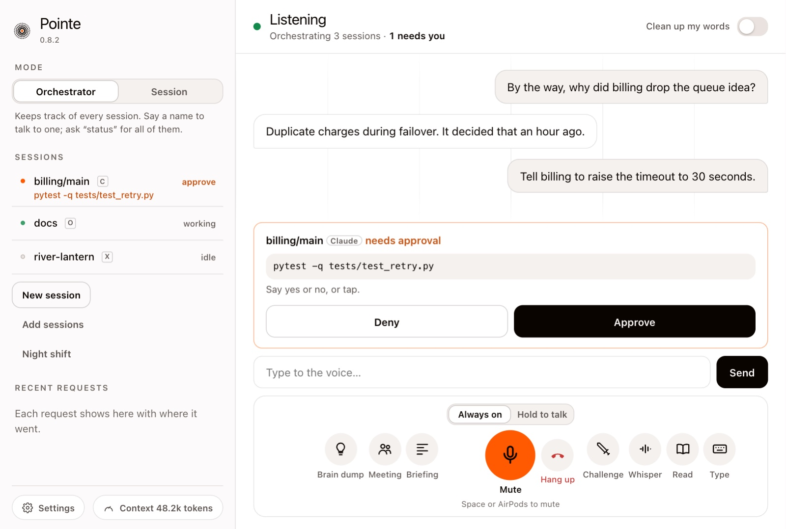

<p align="center">
  <picture>
    <source media="(prefers-color-scheme: dark)" srcset="docs/brand/logo-on-dark.svg">
    
  </picture>
</p>

# Pointe

<p align="center">
  <a href="https://eng.ballerine.com/pointe/"><b>Website</b></a> ·
  <a href="https://eng.ballerine.com/pointe/#install"><b>Download for Mac</b></a> ·
  <a href="https://apps.apple.com/app/id6838678047"><b>iPhone app (App Store)</b></a> ·
  <a href="https://eng.ballerine.com/pointe/docs/"><b>Docs</b></a> ·
  <a href="https://join.slack.com/t/ballerine-oss/shared_invite/zt-4i21px44h-8NJ_ILwisOX~WoRY5xHhVg"><b>Slack</b></a>
</p>

Pointe is a voice layer for your coding agents: talk to every Claude Code, Codex and OpenCode session on your Mac, hear
what each one did, and answer its permission prompts out loud.

<p align="center">
  <picture>
    <source media="(prefers-color-scheme: dark)" srcset="site/pointe/img/hero-web-dark-1600.jpg">
    
  </picture>
</p>

```
You:     What's billing doing?
Pointe:  It finished the retry fix. Tests pass. It wants to know if it should open the PR.
You:     Yes. And tell docs to update the changelog.
Pointe:  Docs is on it.
You:     By the way, why did billing drop the queue idea?
Pointe:  Duplicate charges during failover. It decided that an hour ago.
Pointe:  Billing wants to run: pytest -q tests/test_retry.py. Should it?
You:     Yes.
```

## Install

Beta, for macOS, and for Linux as a hub ([Linux](docs/linux.md)). Setup takes about five minutes and is free with one Google AI Studio key.

1. **Mac.** Download [Pointe.dmg](https://github.com/ballerine-io/pointe/releases/latest/download/Pointe.dmg) from
   [Releases](https://github.com/ballerine-io/pointe/releases/latest) or the
   [website](https://eng.ballerine.com/pointe/#install), drag it to Applications, and open it. The app installs the
   rest, puts your model key in the Keychain and starts your first call.
2. **iPhone** (optional). Get [Pointe: Voice Coding](https://apps.apple.com/app/id6838678047) on the App Store, or try the next version early on
   [TestFlight](https://testflight.apple.com/join/gkRJccpc), or [build it from source](docs/iphone-app.md#getting-the-app)
   with `pointe apps ios`.
3. **Other ways.**
   - Claude Code plugin: run the command below, then `/pointe:setup` in a new session
     ([details](docs/install.md#claude-code)).
   - Codex or OpenCode without Claude Code: the standalone `install.sh`, checked against a SHA-256, no `sudo`
     ([details](docs/install.md#the-standalone-install)).

```
claude plugin marketplace add https://github.com/ballerine-io/pointe.git && claude plugin install pointe@pointe
```

Then join the sessions you want to reach: `/pointe:voice` in a Claude Code session, `pointe join codex` or
`pointe join opencode` in a Codex or OpenCode session's folder. `pointe uninstall` removes Pointe, and asks before it removes your keys.
[What the install puts on your Mac](docs/install.md#what-this-does-to-your-mac), and
[which keys it needs and what they cost](docs/install.md#which-keys).

## What it does

- **One call over every session you joined.** Say a session's name to talk to it. The others stay quiet except for
  "finished" and "needs approval".
- **Approvals by voice, decided by code.** A yes counts only right after Pointe read out the exact command that will
  run, in short for known programs and word for word for the rest. A no from any voice denies.
- **Side questions.** "By the way, why did billing drop the queue idea?" is answered from a read-only copy of the
  session, so the session is not interrupted.
- **Three harnesses in one call.** Claude Code, Codex CLI and OpenCode v2, and
  [sessions on your other machines, and on a machine somebody shares with you](docs/multi-machine.md).
- **Start or join sessions by voice.** "Start a Codex session in shop", "connect to the session about the pentest".
  Pointe reads back what it found and waits for your yes.
- **Three clients.** A browser page, a Mac menu bar app and an iPhone app, each with a live transcript and Approve and
  Deny on the exact request.
- **Your models.** Choose the vendor for each role with your own keys, or run `pointe local`: every model on your Mac,
  no keys, nothing sent out.

Night shift, briefings, push to talk, voice lock and the rest: [all features](docs/features/README.md).

## How it works

- One daemon on your Mac (Python, on [Pipecat](https://github.com/pipecat-ai/pipecat)) listens on `127.0.0.1`. The
  page, the Mac app and the iPhone app each hold one WebSocket to it.
- A call is speech to text, a model that answers you and routes your requests, then text to speech. Each is a vendor
  you chose, or a local model.
- One adapter per session reads its transcript, types your requests into it and holds its permission prompts. In Claude
  Code this is the `PermissionRequest` hook.
- A second model checks each send against what you said. Approvals are decided in code, with tests, not in a prompt.

More: [docs/architecture.md](docs/architecture.md) and [docs/how-it-works.md](docs/how-it-works.md).

## Limits

- **Beta.** A small team uses it every day. Expect rough edges.
- **macOS, or Linux as a hub.** A Linux hub was tested in containers (install, keys, page, a session, pairing, a
  node), but no whole spoken call has been measured there ([Linux](docs/linux.md)). No Windows.
- **One voice per person.** Each Pointe is one person's voice, with one call at a time. Several people can share a
  machine: its owner invites each, and each talks from their own voice. An invited person's requests run as that
  machine's one OS account: Pointe records who asked, it does not isolate them. A prompt goes to the session's owner
  first; the others may answer it after 20 seconds
  ([Machines and people](docs/multi-machine.md#a-shared-machine)).
- **You bring the model keys.** A Claude subscription cannot run Pointe's own models. A paid key costs about $1 for a
  busy hour of talk. Fully local mode needs a 32 GB Mac and is slower and less accurate.
- **Claude Code cannot be interrupted from outside.** "Stop" ends its turn at the next tool step, and a command that is
  already running finishes first. Codex and OpenCode stop at once.
- **A long command is read word for word before a yes counts.** Every request can be approved by voice once it has
  been read in full; most have no short form, so the read-out is long. On a call, a long shell command is first
  sent back to the session to be redone as plain commands. A request that holds a credential-like value is never read
  out and waits for a tap.
- **Use headphones.** On laptop speakers the echo guard works only with Soniox as the speech-to-text vendor.
- **The iPhone reaches your Mac only over a network you set up** (Wi-Fi, Tailscale or a VPN). There is no relay.
- **Vendor-hosted cloud sessions cannot be joined.** Claude Code on the web and Codex Cloud have no interface for it.
- **Most benchmark speech is synthetic.** Only the yes/no approvals and the end-of-turn pauses are measured on
  recorded people. Against a plain LLM-router baseline Pointe is not ahead on every measure:
  [the benchmarks](docs/benchmarks/README.md) say where it loses.

The full list: [docs/limits.md](docs/limits.md). Similar tools, and where each is ahead:
[docs/comparison.md](docs/comparison.md).

## Privacy and security

Pointe runs on your Mac. It has no server, no account and no telemetry, and your keys stay in the macOS Keychain. Your
speech and your sessions' text go only to the model vendors you chose, under your keys; with `pointe local` they go
nowhere. The threat model, including what Pointe does not defend against, is in [SECURITY.md](SECURITY.md); the
[security reviews](docs/security/reviews/README.md) are published with each finding's status. What leaves the Mac,
row by row: [SECURITY.md](SECURITY.md#what-leaves-your-machine).

## Support

[Docs](docs/README.md) · [Slack](https://join.slack.com/t/ballerine-oss/shared_invite/zt-4i21px44h-8NJ_ILwisOX~WoRY5xHhVg) ·
[Q&A](https://github.com/ballerine-io/pointe/discussions/categories/q-a) ·
[Issues](https://github.com/ballerine-io/pointe/issues) · [Roadmap](ROADMAP.md) · [Contributing](CONTRIBUTING.md) ·
[Changelog](CHANGELOG.md) · [Third-party licenses](THIRD_PARTY.md)

Community-supported, best effort, no SLA. Report a vulnerability privately: [SECURITY.md](SECURITY.md).

MIT, © Ballerine. See [LICENSE](LICENSE). Built and open-sourced by Ballerine Engineering.
